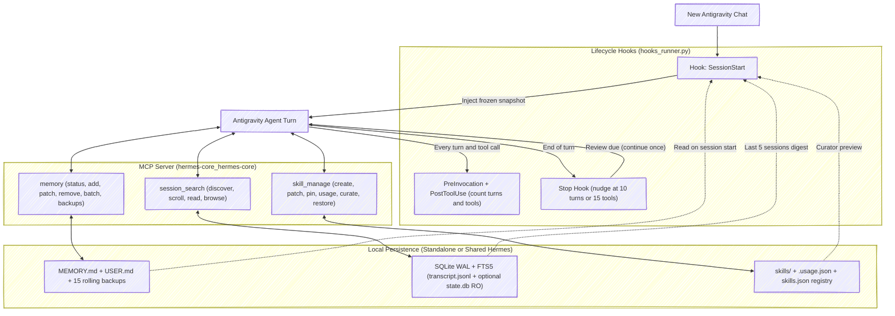
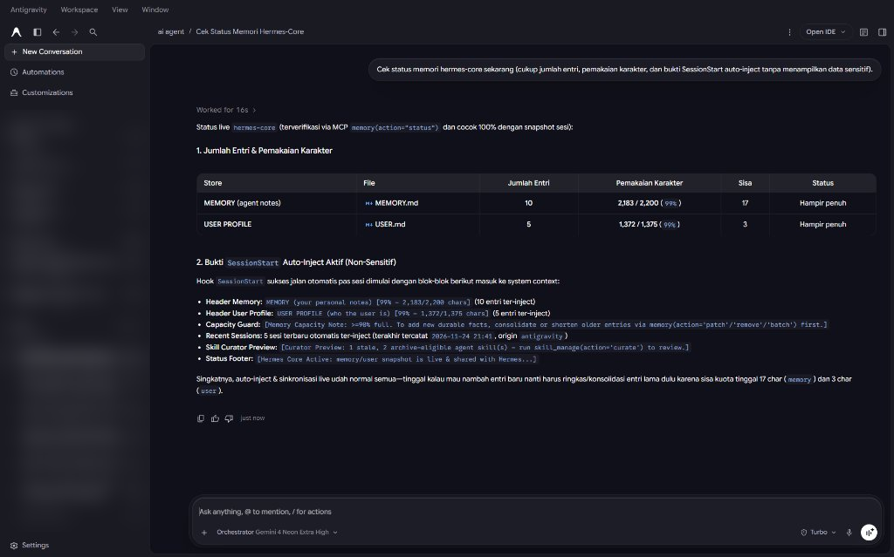
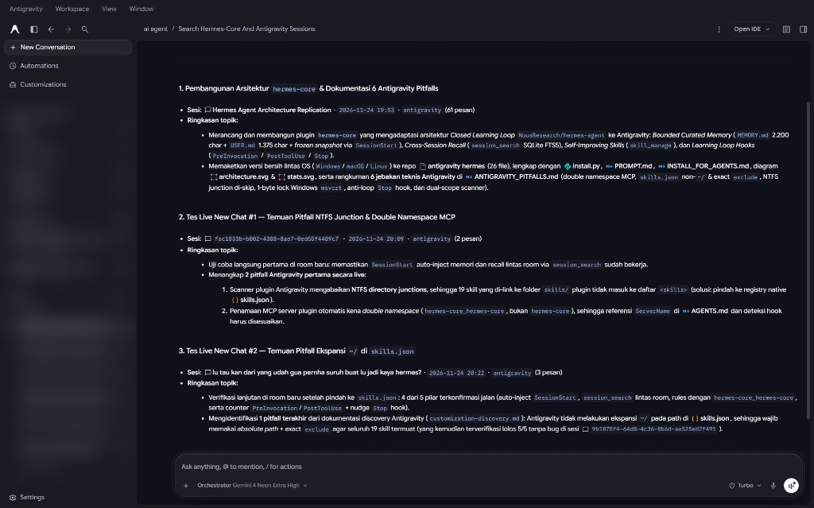
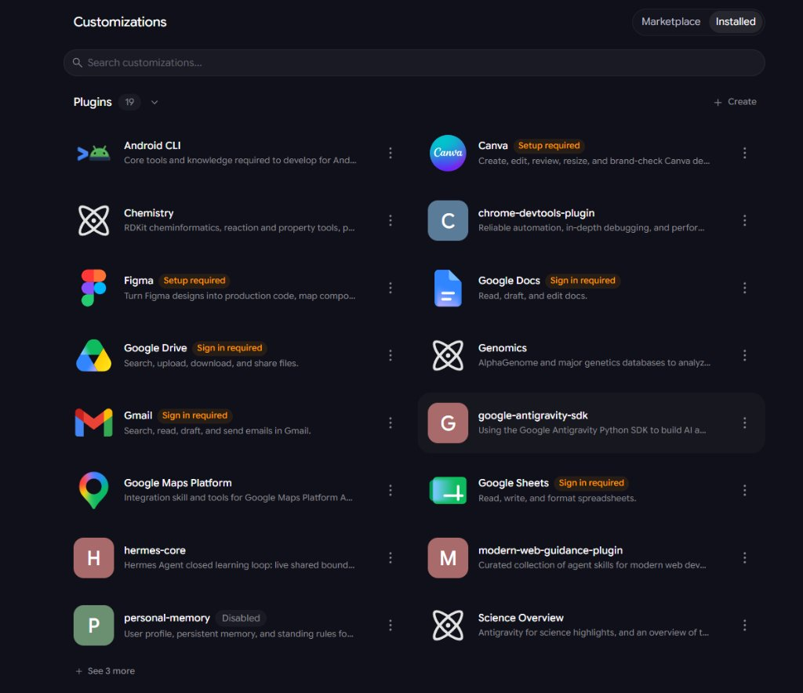
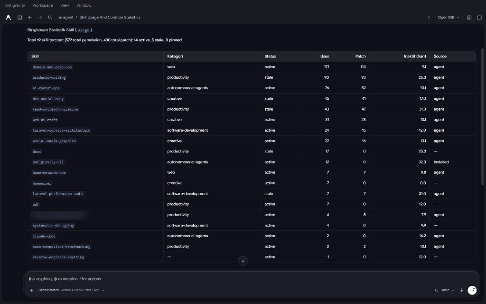
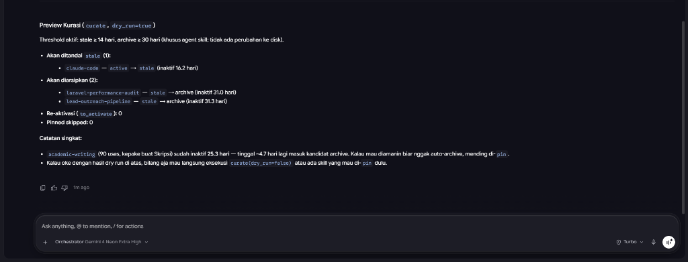

<div align="center">
  <p>
    
    &nbsp;&nbsp;&nbsp;&nbsp;
    
  </p>

  <h1>Antigravity x Hermes Core</h1>

  <p><strong>Bring the NousResearch Hermes Agent closed learning loop into Google Antigravity.</strong></p>
  <p>Persistent bounded memory, SQLite FTS5 cross-session recall, and self-curating skills in one zero-dependency Python plugin.</p>

  <p>
    <a href="https://github.com/vexahostdev/antigravity-architectur-hermes-agent/stargazers"></a>
    <a href="https://github.com/vexahostdev/antigravity-architectur-hermes-agent/actions/workflows/ci.yml"></a>
    <a href="LICENSE"></a>
    
    
    
  </p>

  <p>
    <a href="#quick-start-zero-manual-setup">Quick start</a> &middot;
    <a href="#architecture-specs--honest-scope">Architecture</a> &middot;
    <a href="#live-screenshots">Screenshots</a> &middot;
    <a href="#real-world-antigravity-fixes-baked-in">Pitfalls</a> &middot;
    <a href="PROMPT.md">Zero-clone prompt</a> &middot;
    <a href="INSTALL_FOR_AGENTS.md">Agent spec</a> &middot;
    <a href="#verification">Verification</a>
  </p>

  <p><code>python install.py --mode standalone</code></p>
</div>

Every new chat in Google Antigravity starts blank. `hermes-core` injects your curated `MEMORY.md` and `USER.md` snapshot, a digest of your last five conversations, incremental SQLite FTS5 cross-room search, and self-curating skills via one stdlib Python plugin, an MCP server, and four lifecycle hooks.



---

## Quick start (zero manual setup)

You do not need to install extra packages or configure JSON by hand. Pick any of the three routes below.

### Option A: Paste this GitHub URL into Antigravity (recommended)

Open Antigravity and paste this prompt:

```text
https://github.com/vexahostdev/antigravity-architectur-hermes-agent

Clone or fetch this repository, follow INSTALL_FOR_AGENTS.md, ask me the 3 setup questions first, install hermes-core, and run tests/verify_all.py before finishing.
```

### Option B: Zero-clone copy-paste prompt

If you do not want to clone a repo at all, copy the self-contained build prompt in [PROMPT.md](PROMPT.md) and paste it directly into Antigravity. The agent will ask your setup preferences, generate all 8 Python modules, register the plugin, and run the isolated test suite.

### Option C: One-command local install

On Windows, use `python` instead of `python3`.

```bash
git clone https://github.com/vexahostdev/antigravity-architectur-hermes-agent.git
cd antigravity-architectur-hermes-agent
python3 install.py --mode standalone --scratch-dir ~/antigravity-scratch --projects-dir ~/Projects
python3 tests/verify_all.py
```

Already running Hermes Agent on the same machine? Point `install.py` at your existing `~/.hermes` (or `%LOCALAPPDATA%\hermes`) directory so Antigravity and Hermes share memories, skills, and read-only `state.db` history live:

```bash
python3 install.py --mode shared --scratch-dir ~/antigravity-scratch
```

Re-running `install.py` upgrades server modules without overwriting a customized `rules/AGENTS.md` (pass `--force-rules` to back up and reset it). If another memory plugin (such as `personal-memory`) is already installed in Antigravity, disable it under **Customizations -> Installed** so `SessionStart` does not inject duplicate memory blocks. Then open a **New Chat** so the plugin, MCP server, hooks, and skills load into your session.

### Uninstall

```bash
python3 install.py --uninstall              # Keeps standalone memories/ and skills/
python3 install.py --uninstall --purge-data # Removes everything cleanly
```

---

## Architecture specs & honest scope

| Spec | Value |
| :--- | :--- |
| External dependencies | `0` pip packages (Python 3.10+ stdlib only) |
| Runtime components | `8` Python modules, `3` MCP tools, `4` lifecycle hooks |
| Memory bounds | `MEMORY.md` 2,200 chars, `USER.md` 1,375 chars, `15` rolling backups per store |
| Recall index | SQLite WAL + FTS5 (`sessions_fts.db`), optional read-only Hermes `state.db` bridge |
| Skill Curator | `14d` stale threshold, `30d` archive threshold, `.tar.gz` backups before edits/archives |
| Review nudges | Inline `Stop` hook every `10` turns or `15` tool calls (fail-open on error) |

Most comparisons skip the boundaries. Here is what actually runs inside Antigravity and what stays outside it.

| Hermes Agent capability | Status in Antigravity | How it works |
| :--- | :--- | :--- |
| Bounded curated memory (`MEMORY.md` 2,200 chars, `USER.md` 1,375 chars) | Full parity | `memory` MCP tool (`status`, `add`, `patch`, `remove`, `batch`, `backups`), `§` delimiter, cross-platform locks, 15 rolling backups before writes. |
| Frozen session-start injection | Full parity | `SessionStart` hook injects live `MEMORY.md`, `USER.md`, and a digest of your 5 most recent conversations without breaking prompt caching. |
| Cross-session SQLite FTS5 recall | Full parity | `session_search` indexes Antigravity `transcript.jsonl` files incrementally into WAL+FTS5 (`discover`, `scroll`, `read`, `browse`). Indexed text survives even if you delete a room in the UI. |
| Self-improving skills and Curator | Full parity | `skill_manage` (`list`, `view`, `create`, `edit`, `patch`, `pin`, `unpin`, `usage`, `curate`, `restore`) synced to `.usage.json` (`14d` stale, `30d` archive, `.tar.gz` snapshots) and registered via `~/.gemini/config/skills.json`. |
| Security scanning and redaction | Full parity | Dual-scope `threat_scanner.py` blocks prompt injections, bidi Unicode tricks, SSH backdoors, and hardcoded secrets. `redact_secrets()` masks tokens in search snippets. |
| Learning loop review nudges | Inline hook | `PreInvocation` + `PostToolUse` track turns and tool calls. `Stop` triggers `[Hermes Learning Loop Review]` at 10 turns or 15 tool calls (inline instead of a background thread). |
| Goals, cron, subagents, workflows | Native Antigravity | Handled natively by `/goal`, `/schedule`, subagents/`swarm`, `run_workflow`, `/learn`, and `/compact`. |
| 24/7 Telegram / WhatsApp / Discord gateway | External daemon | Antigravity is a desktop/CLI client. If you need 24/7 messaging bots, keep a standalone Hermes gateway running on a VPS and sync `memories/` and `skills/`. |

---

## What gets installed

```text
~/.gemini/config/
├── config.json                      # Enables hermes-core
├── skills.json                      # Absolute paths + exact hidden folder excludes
└── plugins/
    └── hermes-core/
        ├── plugin.json
        ├── mcp_config.json          # Stdio MCP server: hermes-core_hermes-core
        ├── hooks.json               # SessionStart, PreInvocation, PostToolUse, Stop
        ├── rules/
        │   └── AGENTS.md            # SOUL.md directness + learning loop instructions
        ├── server/
        │   ├── common.py            # Paths, cross-platform locks, atomic writes, redactor
        │   ├── threat_scanner.py    # Dual-scope strict/skill security scanner
        │   ├── memory_store.py      # Bounded MEMORY.md/USER.md + 15 rolling backups
        │   ├── fts_indexer.py       # SQLite WAL+FTS5 indexer + optional Hermes state.db RO bridge
        │   ├── skill_curator.py     # .usage.json telemetry, pins, .tar.gz curator backups
        │   ├── skill_manager.py     # Skill CRUD + skills.json absolute-path sync
        │   ├── hermes_mcp.py        # Zero-dep JSON-RPC 2.0 MCP server
        │   └── hooks_runner.py      # Fail-open lifecycle hook dispatcher
        └── data/
            ├── plugin_settings.json # standalone or shared mode config
            ├── sessions_fts.db      # Local FTS5 index
            └── hook_state.json      # Per-conversation counters (7-day TTL)
```

---

## Live screenshots

Captured from a live Antigravity session with `hermes-core` active (private sidebars and custom brand names blurred).

| New chat auto-memory recall | Cross-session FTS5 search |
| :---: | :---: |
|  |  |
| **Plugin active in Customizations** | **Skill usage telemetry (`usage`)** |
|  |  |

**Skill Curator dry-run preview (`curate`, `dry_run=true`)**



---

## Real-world Antigravity fixes baked in

Building this surfaced six non-obvious Antigravity behaviors (double-namespaced `hermes-core_hermes-core` MCP IDs, `skills.json` rejecting `~/` and regex excludes, plugin scanners skipping directory junctions, Windows `msvcrt` zero-byte lock traps, `Stop` hook `continuationActive` loops, and dual-scope strict/skill security scanning). Read the full breakdown in [docs/ANTIGRAVITY_PITFALLS.md](docs/ANTIGRAVITY_PITFALLS.md).

---

## Verification

Run the isolated test suite anytime without touching live user memories, skills, or configs:

```bash
python3 tests/verify_all.py
```

It exercises `install.py` (deployment, upgrade rule preservation, and `--uninstall`), MCP JSON-RPC calls, memory bounds and 15-file backup rotation, FTS5 search/redaction/deletion survival, skill CRUD/pinning/curator backups/restore, and all four lifecycle hooks inside a temporary directory.

---

## Star history

<a href="https://www.star-history.com/#vexahostdev/antigravity-architectur-hermes-agent&Date">
  <picture>
    <source media="(prefers-color-scheme: dark)" srcset="https://api.star-history.com/svg?repos=vexahostdev/antigravity-architectur-hermes-agent&type=Date&theme=dark" />
    <source media="(prefers-color-scheme: light)" srcset="https://api.star-history.com/svg?repos=vexahostdev/antigravity-architectur-hermes-agent&type=Date" />
    
  </picture>
</a>

---

## Attribution & License

Architecture inspired by [NousResearch/hermes-agent](https://github.com/NousResearch/hermes-agent) (MIT License). Google Antigravity and Hermes Agent marks belong to their respective owners. Licensed under [MIT](LICENSE).
